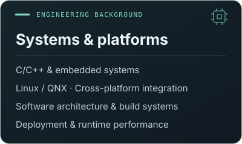
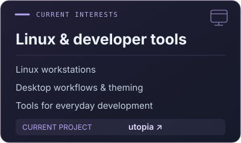
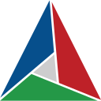

  

  

## About me

I'm a software engineer with a background in **C/C++**, **embedded systems**, and **cross-platform integration on Linux and QNX**.

I like understanding how software is built, deployed, and made to work across different environments. Here on GitHub, I explore Linux workstations and developer tools.

  
  

  <strong>Languages</strong> 
  &nbsp;C &nbsp;
  &nbsp;C++ &nbsp;
  &nbsp;Python &nbsp;
  &nbsp;Shell

  <strong>Platforms &amp; tools</strong> 
  &nbsp;Linux &nbsp; QNX &nbsp;
  &nbsp;CMake &nbsp; Conan &nbsp; Bazel &nbsp;
  &nbsp;Git

## Contribution trail

<picture>
  <source media="(prefers-color-scheme: dark)" srcset="./assets/contributions-dark.svg" />
  <source media="(prefers-color-scheme: light)" srcset="./assets/contributions.svg" />
  
</picture>
