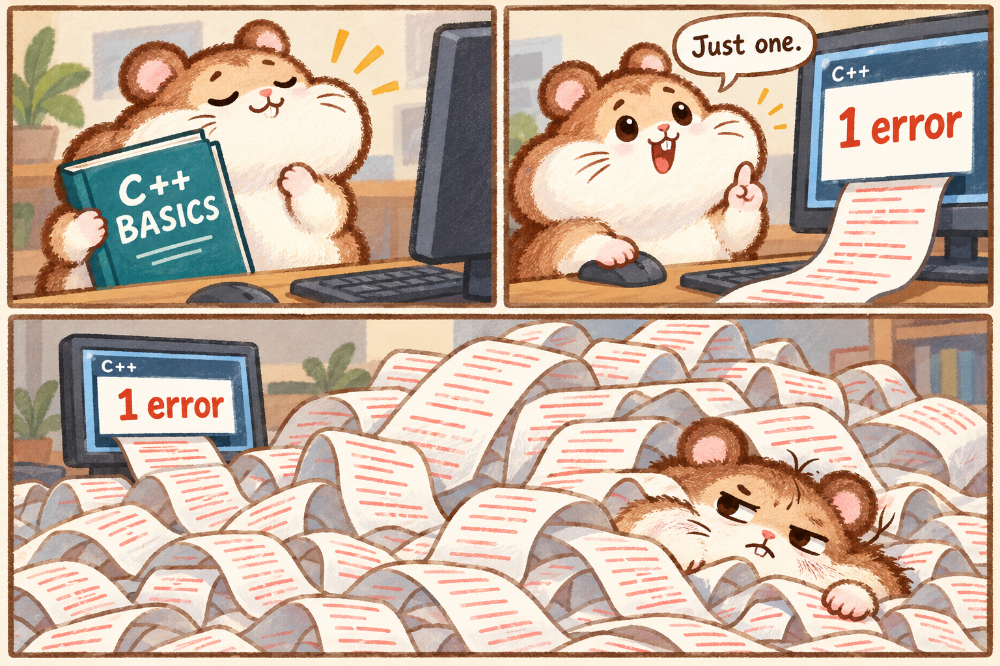

# 一个错误：先看包袱的三格分镜

**最新反馈（2026-10-30）：** 用户看后续动画成片后评价「不怎么样」。该方向当前不采用，不把早先的「继续」记成笑点认可；分镜与动画保留为历史。

2026-10-30。用户在C++笑话与漫画研究后说「继续」。助手将「以为已经过关，结果被新一层难题拆台」落到一条具体情节，以内置imagegen制作三格漫画，**仅供检查笑点，用户尚未认可新剧情，没有替换主页或制作新动画。**

后续用户再次说「继续」后，已接为[独立本地动画候选](../../drafts/one-error/NOTES.md)。这表示继续制作，不等于最终认可或发布；本页保留分镜阶段记录。

1. 仓鼠合上C++入门书，神情得意，准备动手。
2. 编译器显示「1 error」，它觉得只有一个问题，轻松地说「Just one.」。
3. 同一个错误的诊断说明不断涌出，堆成纸山，把仓鼠埋住；屏幕仍显示「1 error」，它只露出疲惫、无语的脸。

包袱在小数字与夸张结果之间，以及前后心理预期的落差。纸带是长诊断信息的视觉比喻，不代表实际工作中使用打印机查看编译器输出。这里借鉴了[参考4的小错误／长诊断](../README.md)和角色状态对照，不复制参考漫画的构图、卡通角色或具体文案。

已查看图片：三个节拍及「1 error」前后呼应可见，角色的圆耳、鼓腮、鼻子、门牙、胡须延续已有形象。文字清晰，但笑点是否令用户满意仍待反馈，不能因已画出就认定已经成立。

图片为1536×1024 PNG；原始生成结果未改绘。使用[完整提示词与参考记录](PROMPT.md)；主页既有头像、Bio、整页内容及原动画均未修改。本轮没有重新列多套方向或要求用户选择样式。
