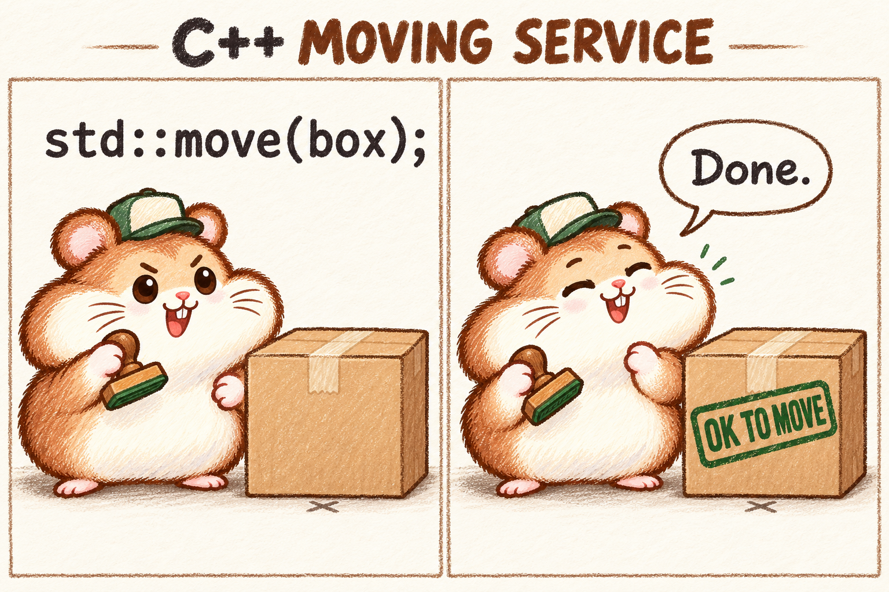

# C++ 搬家公司：两格语义冷笑话试稿

2026-10-30。上一版「一个错误／纸山」动画被用户评价为「不怎么样」。本稿是助手据此提出的新试验，并未获得用户认可；只做一张静态两格漫画，不接入主页、不做动画。

**后续反馈：** 用户认为该梗「太细节了」，需要了解C++语法才能看懂，本笑点不采用。随后用户补充「但是你上面画的图里的仓鼠倒是挺可爱的」：角色形象有明确正反馈，可作为后续画风与表情参考，不等于采用搬家公司剧情或继续制作此动画。下一稿的笑点应不依赖C++语法知识。



使用内置 imagegen，参考 `../../drafts/one-error/assets/scene/hamster-ready.png` 的角色形象和绘画质感，不复制动作或表情。输出原图保存为同目录 `move-permission.png`。

原始生成结果：`/home/chikee/.codex/generated_images/01a16d36-aa0a-7a23-acb8-b3e14fddf84a/exec-f81ec7c4-b005-4e65-9b43-4676ec817806.png`。已将原图复制入仓库，没有裁剪或改绘。

## 技术依据与表达边界

已查看 [C++ 标准草案 forward/move helpers](https://eel.is/c++draft/forward#10)：`std::move` 返回相应的右值引用转换表达式，本身不执行资源转移。漫画用「只盖允许搬走的章」表现名称与实际工作的反差，这是助手提出的拟人化冷笑话，不是技术教程；不宣称实际修改了对象类型或设置了运行时许可。

补充检索看到的 `friend/private` 等文字段子、MonkeyUser 标签页没有产出新的可直接借鉴的漫画，不追加到原有「实际看过七个图文样本」的统计中。

## 完整提示词

```text
Use case: illustration-story.
Asset: one compact two-panel editorial comic concept, landscape 1536 x 1024. This is a quick humor audition, not a website mockup, not an animation sprite sheet.

Reference image role: use the attached brown-and-cream hamster as a character and medium reference ONLY. Preserve round pink ears, enormous cream cheeks, little pink nose, visible incisors, whiskers, brown expressive brows, and the warm textured pencil/gouache drawing. Invent new poses and facial expressions appropriate to this gag. Do not reuse its raised-finger pose.

The gag: a C++ moving service performs std::move on a box. The service never carries the box anywhere; it merely stamps it OK TO MOVE, then proudly calls the job done. This is dry, deadpan humor about permission to move versus actually moving. Both panels show the same box in exactly the same location relative to a faint floor marker. No movement lines on the box. There is no disaster, no huge pile, no crying character.

Composition: two equal panels side by side with a thin pencil dividing line, plenty of clean warm-white paper around the action, almost no scenery. One small heading spanning both panels at top, exact text "C++ MOVING SERVICE". Restrained charcoal and warm brown lettering, muted forest-green stamp ink. The hamster wears a plain small mover's cap, no clothing beyond this, round compact body.

Left panel: the hamster stands beside an ordinary taped cardboard box on the floor. It has rolled up its figurative sleeves, looks businesslike and ready to get moving, and holds a small rubber stamp in one paw. Above this scene a single large, crisply legible monospace code line reads exactly "std::move(box);". The box has no text, no symbols except simple packing tape. Put a tiny faint X floor marker just underneath the middle of the box, visible at its edge, to show position.

Right panel: same framing, same box and floor marker, same size, same place, still on the floor. The only change to the box is a large fresh forest-green rubber-stamp impression reading exactly "OK TO MOVE". The hamster stands just beside it, stamp in hand, looking extremely pleased with its own minimal effort, eyes half closed in smug satisfaction; its other paw makes a tiny satisfied gesture. A short speech balloon reads exactly "Done." The contrast should feel like a moving company that did paperwork rather than any moving, a small absurdity one can read immediately.

Text must be limited to the four exact strings specified: "C++ MOVING SERVICE", "std::move(box);", "OK TO MOVE", "Done." Make all text large and spelled correctly. No explanatory footer, no extra narration or speech, no technical type labels, no lvalue/rvalue diagrams, no watermark. No computer screens, books, avalanches, paper heaps, thumb-up gag, or impacts. Do not make a detailed polished website or add generic technology icons. The funny performance and unchanged box should be the focus.
```
