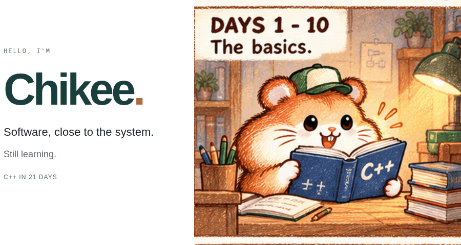
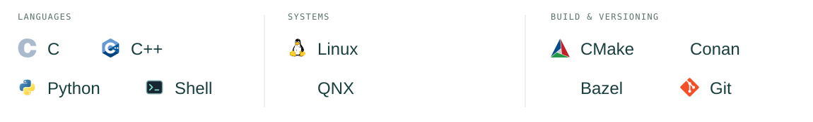
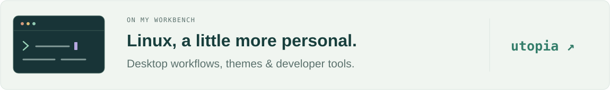

<picture>
  <source media="(max-width: 600px) and (prefers-color-scheme: dark) and (prefers-reduced-motion: reduce)" srcset="./assets/hero-mobile-dark-still.png" />
  <source media="(max-width: 600px) and (prefers-reduced-motion: reduce)" srcset="./assets/hero-mobile-light-still.png" />
  <source media="(prefers-color-scheme: dark) and (prefers-reduced-motion: reduce)" srcset="./assets/hero-dark-still.png" />
  <source media="(prefers-reduced-motion: reduce)" srcset="./assets/hero-light-still.png" />
  <source media="(max-width: 600px) and (prefers-color-scheme: dark)" srcset="./assets/hero-mobile-dark.gif" />
  <source media="(max-width: 600px)" srcset="./assets/hero-mobile-light.gif" />
  <source media="(prefers-color-scheme: dark)" srcset="./assets/hero-dark.gif" />
  
</picture>

Story adapted from <a href="https://abstrusegoose.com/249">Abstruse Goose #249</a>.

<h3>Where the pieces meet</h3>

I work with <strong>C/C++ and embedded systems</strong> — software architecture, cross-platform integration, and getting things to run on <strong>Linux and QNX</strong>.

I like the part where the pieces have to fit: the build, the deployment, and what actually happens at runtime.

<picture>
  <source media="(max-width: 600px) and (prefers-color-scheme: dark)" srcset="./assets/tools-mobile-dark.svg" />
  <source media="(max-width: 600px)" srcset="./assets/tools-mobile-light.svg" />
  <source media="(prefers-color-scheme: dark)" srcset="./assets/tools-dark.svg" />
  
</picture>

<h3>A workbench of my own</h3>

Here on GitHub, I tinker with <strong>Linux workstations and developer tools</strong> — how a development environment looks, feels, and fits together. A current rabbit hole: wallpaper-driven desktop themes.

<a href="https://github.com/imchikee/utopia">
<picture>
  <source media="(max-width: 600px) and (prefers-color-scheme: dark)" srcset="./assets/workbench-mobile-dark.svg" />
  <source media="(max-width: 600px)" srcset="./assets/workbench-mobile-light.svg" />
  <source media="(prefers-color-scheme: dark)" srcset="./assets/workbench-dark.svg" />
  
</picture>
</a>

<h3>A little trail of activity</h3>

<picture>
  <source media="(prefers-color-scheme: dark)" srcset="./assets/contributions-dark.svg" />
  
</picture>

About those 21 days…

The syllabus took a few unexpected turns.

