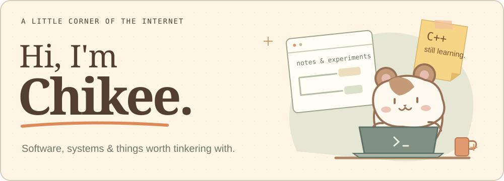
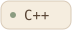
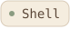
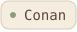

## A little about me

I'm **Chikee**, a software engineer working with **C/C++, embedded systems, and software architecture**.

Much of my work is about getting software to build, run, and work across different platforms. **Linux and QNX** are familiar territory.

## On my workbench

Here on GitHub, I tinker with **Linux workstations and developer tools** — how a development environment looks, feels, and fits together.

Some of that tinkering lives in **[utopia →](https://github.com/imchikee/utopia)**, my project for reproducible Linux workstation setups.

## Tools I reach for

**Languages**

   

**Platforms &amp; build tools**

     

## A trail of commits

<picture>
  <source media="(prefers-color-scheme: dark)" srcset="./assets/contributions-dark.svg" />
  <source media="(prefers-color-scheme: light)" srcset="./assets/contributions.svg" />
  
</picture>

