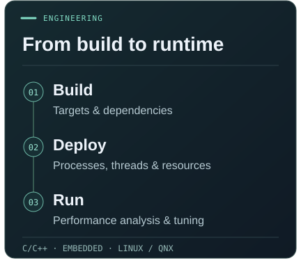
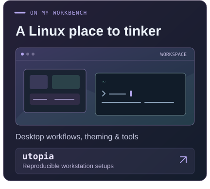
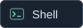
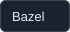

<picture>
  <source media="(max-width: 600px)" srcset="./assets/header-mobile.svg" />
  
</picture>

<h2>About me</h2>

I'm <strong>Chikee</strong>, a software engineer working with <strong>C/C++ and embedded systems</strong>, with a focus on <strong>software architecture and cross-platform integration</strong>.

Here on GitHub, I tinker with <strong>Linux workstations and developer tools</strong>. Some of that lives in <a href="https://github.com/imchikee/utopia"><strong>utopia →</strong></a>.

  
  

<h2>Tools I reach for</h2>

<strong>Languages</strong> 
   

<strong>Platforms &amp; build tools</strong> 
     

<h2>Contribution trail</h2>

<picture>
  <source media="(prefers-color-scheme: dark)" srcset="./assets/contributions-dark.svg" />
  
</picture>
