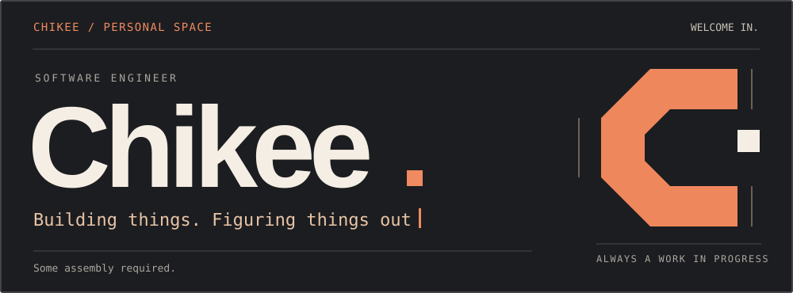
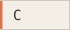
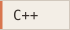
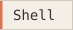
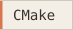
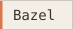
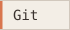
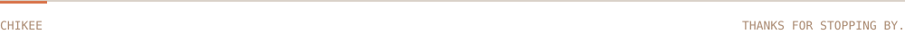

I'm **Chikee**. I work with **systems software** and enjoy understanding how the pieces fit together.

<table width="100%">
<tr>
<td width="50%" valign="top">
<h3>Engineering</h3>

<strong>C/C++ · embedded systems</strong>

Software architecture, cross-platform builds, deployment, and runtime performance.

</td>
<td width="50%" valign="top">
<h3>Exploring</h3>

<strong>Linux · developer tools</strong>

Tinkering with workstation setups, desktop workflows, and tools for everyday development.

</td>
</tr>
</table>

Some of that tinkering lives in **[utopia →](https://github.com/imchikee/utopia)**, my project for reproducible Linux workstation setups.

## Tools of the trade

**Languages**

   

**Platforms &amp; build tools**

     

## A trail of commits

<picture>
  <source media="(prefers-color-scheme: dark)" srcset="./assets/contributions-dark.svg" />
  <source media="(prefers-color-scheme: light)" srcset="./assets/contributions.svg" />
  
</picture>

