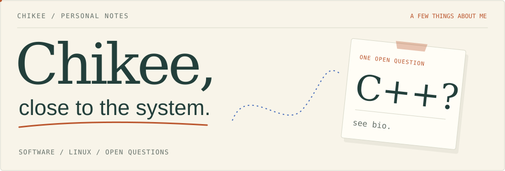
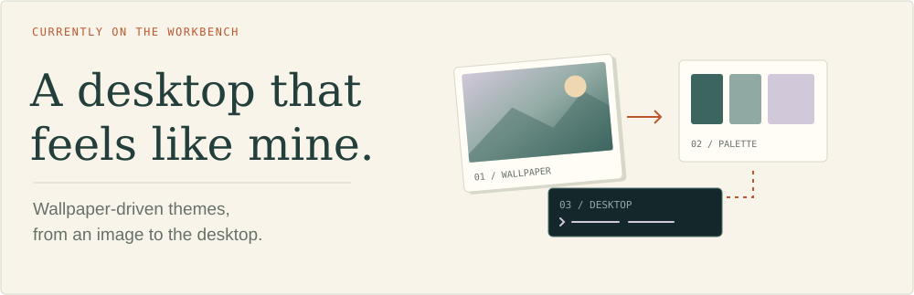
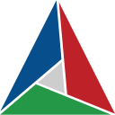

<picture>
  <source media="(max-width: 600px) and (prefers-color-scheme: dark)" srcset="./assets/folio-mobile-dark.svg" />
  <source media="(max-width: 600px)" srcset="./assets/folio-mobile-light.svg" />
  <source media="(prefers-color-scheme: dark)" srcset="./assets/folio-dark.svg" />
  
</picture>

I'm <strong>Chikee</strong>. My background is in <strong>C/C++ and embedded systems</strong>, with work across software architecture, cross-platform integration, and runtime performance on Linux and QNX.

I like understanding how software fits together — from its build to the machine it runs on.

<picture>
  <source media="(max-width: 600px) and (prefers-color-scheme: dark)" srcset="./assets/theme-note-mobile-dark.svg" />
  <source media="(max-width: 600px)" srcset="./assets/theme-note-mobile-light.svg" />
  <source media="(prefers-color-scheme: dark)" srcset="./assets/theme-note-dark.svg" />
  
</picture>

Here on GitHub, I explore <strong>Linux workstations and developer tools</strong>. One current rabbit hole: how a wallpaper can shape the desktop around it.

Some of that tinkering lives in <a href="https://github.com/imchikee/utopia"><strong>utopia ↗</strong></a>, my Linux workstation project.

<h2>A few things on the desk</h2>

<strong>Languages</strong> &nbsp;C &nbsp; &nbsp;C++ &nbsp; &nbsp;Python &nbsp; &nbsp;Shell

<strong>Platforms</strong> &nbsp;Linux &nbsp; QNX

<strong>Builds &amp; version control</strong> &nbsp;CMake &nbsp; Conan &nbsp; Bazel &nbsp; &nbsp;Git

<h2>A little trail of activity</h2>
<picture><source media="(prefers-color-scheme: dark)" srcset="./assets/contributions-dark.svg" /></picture>
